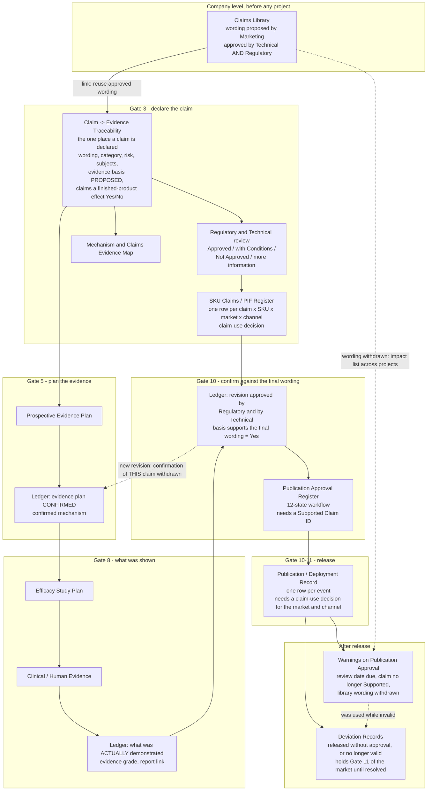

# The life of a claim: which registers it passes through

A claim is **declared once**, in `Claim -> Evidence Traceability`, and every later use refers to it by **Claim ID** (`CLM-001`). Nothing re-types its wording. This page follows one claim from the company's Claims Library to a deviation after release.

Status: describes the application as of 2026-11-26 (after Round 5 questions 17-28). The rules behind each step are in `CLAUDE.md` and `docs/rules/`; this page only shows how they fit together.

## Diagram

## Step by step

| When | Register | What happens to the claim | Who |
|---|---|---|---|
| Before any project | **Claims Library** (Company Reference Data) | Wording is proposed; it becomes "Approved Library Wording" only when Technical **and** Regulatory both approve. Withdrawing it lists every project, SKU and market that used it. | Marketing proposes; Technical and Regulatory approve |
| Gate 3 | **Claim -> Evidence Traceability** | Declared once with a generated ID. Wording, category and risk come from the linked library entry; a claim with no link is a new claim and is typed. Records the proposed evidence basis and whether the claim states an effect of the finished product. | Content owner |
| Gate 3 | Same ledger, review columns | Regulatory (and Technical where the library does not cover it) review. Outcomes: Approved, Approved with Conditions, Not Approved, Further information required. A rejected concept leaves the active scope but the record stays. | Regulatory Claims and Technical Claims holders of the project |
| Gate 3 | **SKU Claims / PIF Register** | One row per claim x SKU x market x channel (`CU-001`). Holds the claim-use decision: Approved / Approved with Conditions / Not Approved / Withdrawn. | Regulatory, Technical as required |
| Gate 3 | **Mechanism & Claims Evidence Map** | Links the claim to its mechanism and evidence. | Formulation / R&I |
| Gate 5 | **Prospective Evidence Plan**, then the ledger | The evidence plan is confirmed per claim, in the confirmer's own name, before formula lock. After that the evidence basis changes only through a new revision. | Review team of the sheet |
| Gate 8 | **Efficacy Study Plan**, **Clinical / Human Evidence**, then the ledger | Studies are planned and run; the ledger records what was actually demonstrated, the evidence grade and the report link. | R&I / study team |
| Gate 10 | Ledger revision columns | Regulatory and Technical each approve the revision in their own name; the demonstrated basis must support the final wording (only "Yes" passes). An approved revision is read-only: a change needs a new revision or a new Claim ID. | Regulatory Claims and Technical Claims holders |
| Gate 10 | **Publication Approval Register** | Any public content (website, social, brochure, label text…) names its Claim ID and goes through the 12-state workflow. A claim that is not Supported cannot reach "Approved for Release". | Content owner, reviewers, final approver |
| Gate 10-11 | **Publication / Deployment Record** | Each event is one row (Release to Print, Published/Deployed, Updated, Withdrawn, Superseded). Putting something out needs a claim-use decision that covers that market and channel and the claim's current revision. | Person responsible |
| After release | **Publication Approval** warnings | Released content past its review date, with a claim no longer Supported, or whose library wording was withdrawn, is listed for its owner until a disposition is recorded. A due review date asks for a re-review; it does not prove unlawful publication. | Content owner |
| After release | **Deviation Records** | Something released without approval, or no longer valid, is logged. The original incident is preserved, the row is never deleted, and an unresolved safety, compliance, claims or version-mismatch deviation holds that market's Gate 11. | Regulatory / Quality people of the project |

## Rules that run through the whole life

- **One declaration, many references.** Every register above that mentions a claim holds a Claim ID picked from the ledger, never retyped wording.
- **Revisions, not edits.** Once a revision is approved (or, for the evidence basis, once the plan is confirmed), changing what the approval covers needs a new revision. A new revision withdraws the confirmation of that claim alone; nothing later is backtracked automatically.
- **Exemption is narrow.** A Cosmetic claim may rely on ingredient-level evidence only if the claim itself says it does not claim an effect of the finished product.
- **Release follows use decisions.** What may appear on artwork, in published content and in the publication record is decided by the claim-use decision for that exact market and channel.
- **People are assignments.** Every approval above is recorded by the person assigned to that function on the project (set when the project is created), in their own name.
